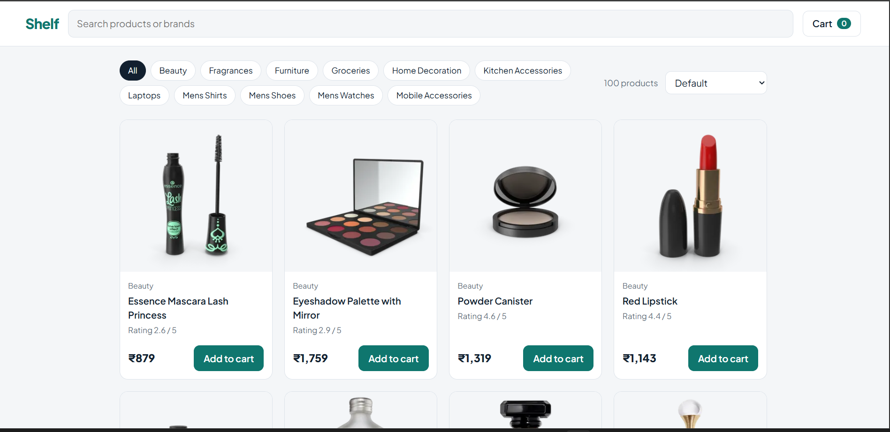

# Shelf - React Product Explorer

 **Live demo:** https://shelf-store-products.vercel.app/
 
 

A responsive product store front-end built with React and Vite.
Product data comes from the free DummyJSON demo API (no API key needed).
The API sends prices in US dollars, so the app converts them to INR with a fixed rate for display.

## Features
- Products loaded from an API with the Fetch API (loading, error and empty states)
- Search by product name or brand
- Category filter and sorting (price, rating)
- Shopping cart: add, change quantity, remove, clear, total price
- Cart is saved in localStorage, so it stays after a refresh
- Responsive layout

## React concepts used
- Components and props
- useState and useEffect
- Rendering lists with map() and keys
- Conditional rendering (loading, error, empty)
- Controlled input (search box)

## Run locally
```bash
npm install
npm run dev
```
Open the link shown in the terminal (usually http://localhost:5173).

## Folder structure
```
src/
  api/products.js          get products from the API
  utils/formatPrice.js     dollar to rupee conversion
  components/
    Header.jsx             logo, search, cart button
    Filters.jsx            category buttons and sorting
    ProductGrid.jsx        list of products + loading/error states
    ProductCard.jsx        one product card
    CartDrawer.jsx         cart panel
  App.jsx                  main state and logic
  main.jsx                 starts the app
  index.css                all styles
```
